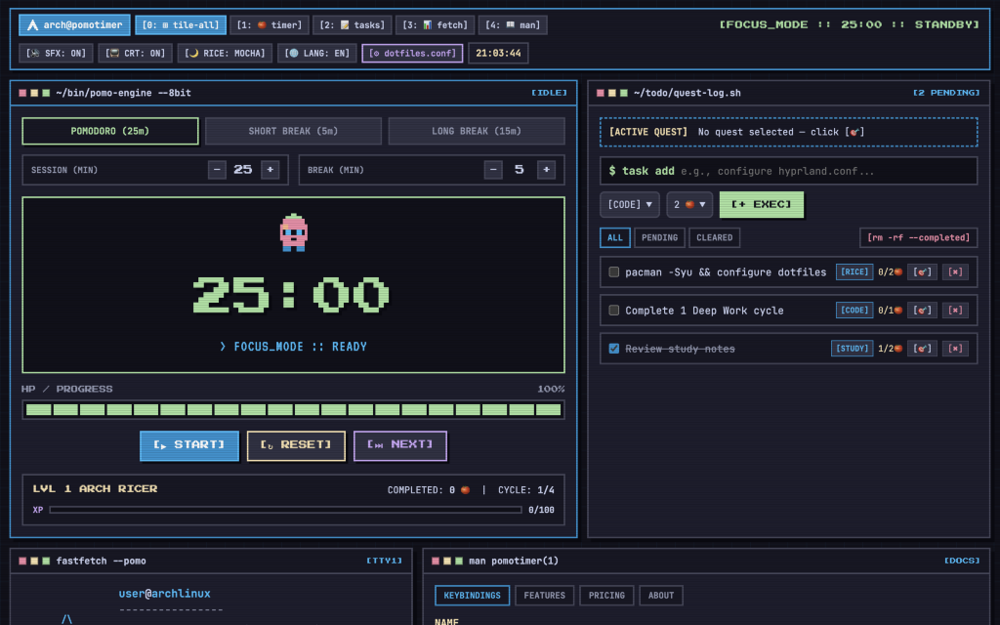

# 🍅 PomoArch

> **Pomodoro Timer & Quest Log** with an **Arch Linux (`r/unixporn`) Tiling Window Manager** rice blended with an **8-Bit Retro Arcade / RPG HUD** aesthetic.


---

## 📸 Preview



---

## ✨ Features

- **Waybar / Polybar Top Status Bar**
  - Workspace switcher (`[0: ⊞ tile-all]`, `[1: 🍅 timer]`, `[2: 📝 tasks]`, `[3: 📊 fetch]`, `[4: 📖 man]`) to view the full tiling grid or focus a single window.
  - Live status ticker, system clock, **8-bit SFX** toggle, **CRT scanlines** toggle, **Catppuccin Mocha / Latte** theme switch, and **EN / PT** language toggle.
- **8-Bit Pomodoro Engine (`~/bin/pomo-engine --8bit`)**
  - Focus (`25m`), Short Break (`5m`), and Long Break (`15m`) modes with inline `-` / `+` duration adjusters.
  - Custom 16×16 pixel-art Tomato Hero sprite and a 20-segment 8-bit HP/Progress bar.
  - Built-in **Web Audio API chiptune synthesizer** for start, pause, completion, and quest SFX (no external audio files required).
  - RPG progression system with **Level**, **XP bar**, completed Pomodoros, and 4-cycle tracker.
- **Terminal Quest Log (`~/todo/quest-log.sh`)**
  - CLI-styled task input (`$ task add`) with tags (`[CODE]`, `[STUDY]`, `[RICE]`, `[BOSS]`) and estimated Pomodoro counts.
  - Set any task as your **Active Quest** (`[🎯]`) to track Pomodoros against it automatically.
  - Filter by `ALL`, `PENDING`, `CLEARED`, or purge completed tasks with `[rm -rf --completed]`.
  - Automatically persisted in `localStorage` and synced to cookies.
- **System Telemetry (`fastfetch --pomo`)**
  - ASCII Arch Linux logo alongside live Focus Time, Cleared Quests, Pomodoros, and Streak counters.
- **`dotfiles.conf` Modal Settings**
  - Native `<dialog>` configuration editor for custom durations, SFX volume, auto-start toggles, CRT scanlines, and locale (`en_US.UTF-8` / `pt_BR.UTF-8`).
- **Auto-Detected i18n (`en` / `pt`)**
  - Automatically detects the client browser language (`pt*` → Portuguese, everything else → English default) and persists manual switches.

---

## ⌨️ Keyboard Shortcuts

| Key | Action |
| :--- | :--- |
| <kbd>Space</kbd> | Start / Pause current timer |
| <kbd>R</kbd> | Reset current timer phase |
| <kbd>N</kbd> | Skip to next phase (Focus / Break) |
| <kbd>/</kbd> | Focus `$ task add` input |
| <kbd>1</kbd> - <kbd>3</kbd> | Switch mode (Pomodoro / Short Break / Long Break) |

---

## 🚀 Quick Start

No build step or dependencies required — just open `index.html` or serve the directory with any static server:

```bash
git clone https://github.com/b92c/pomoarch.git
cd pomoarch
python3 -m http.server 8080
```

Then open `http://localhost:8080` in your browser.

---

## 👤 Author

Developed by **[b92c (Brayann Barbosa)](https://github.com/b92c)**
